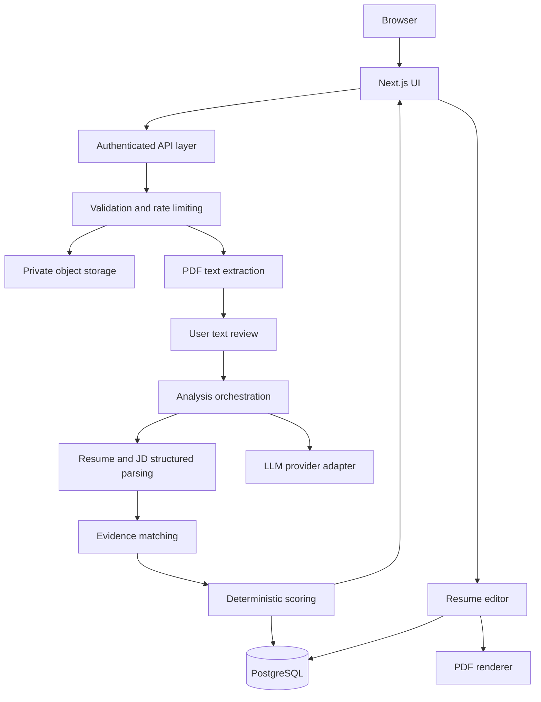

# Technical Architecture — ResumeFit AI

Version: 1.0 | Architecture style: modular monolith

## 1. Stack

- Next.js App Router, TypeScript, React
- Tailwind CSS, shadcn/ui, React Hook Form, Zod
- Next.js route handlers/server actions for application APIs
- Supabase PostgreSQL, Supabase Auth, private Supabase Storage
- AI model behind a provider adapter (initial candidate: Gemini)
- PDF.js or pdf-parse for text extraction; @react-pdf/renderer for PDF output
- Vitest, React Testing Library, Playwright
- Vercel for web deployment; managed background jobs/queue if request timeouts require it

Use maintained versions compatible at implementation time; pin versions and check licenses and security advisories.

## 2. Logical architecture



The text review is a client-visible checkpoint: extraction returns text to the user, and a subsequent request starts analysis after confirmation.

## 3. Repository structure

```text
src/
  app/
    (marketing)/page.tsx
    (app)/dashboard/page.tsx
    (app)/analyze/page.tsx
    (app)/reports/[id]/page.tsx
    (app)/resumes/[id]/edit/page.tsx
    api/uploads/route.ts
    api/extract/route.ts
    api/analyses/route.ts
    api/analyses/[id]/route.ts
    api/resumes/route.ts
    api/resumes/[id]/route.ts
    api/resumes/[id]/export/route.ts
  components/{layout,upload,analysis,report,resume,ui}/
  features/{auth,documents,analysis,builder}/
  lib/{supabase,ai,pdf,validation,security,observability}/
  server/{repositories,services,policies}/
  types/
tests/{unit,integration,e2e,fixtures,evaluations}/
supabase/migrations/
```

## 4. Data model

Use UUID primary keys, created_at/updated_at timestamps, row-level security and ownership policies.

| Entity | Key fields | Notes |
|---|---|---|
| profiles | id (auth user ID), display_name, preferences | No unnecessary personal data |
| documents | id, user_id nullable, type, storage_key nullable, extracted_text, extraction_status, expires_at | Guest documents use scoped temporary tokens; purge on expiry |
| resumes | id, user_id, title, current_version_id | Saved resume metadata |
| resume_versions | id, resume_id, structured_json, template_id, created_at | Immutable revisions |
| job_profiles | id, user_id nullable, input_mode, title, source_document_id, normalized_json, confidence | Distinguish full JD and generic role |
| analyses | id, user_id nullable, resume_version_id nullable, job_profile_id, status, scores_json, findings_json, confidence, expires_at | Guest records scoped to session |
| analysis_evidence | id, analysis_id, requirement_key, source_excerpt, source_section, match_status, confidence | Traceability |
| usage_events | id, user_id nullable, event_type, token_count, cost_estimate, created_at | Avoid raw document content |

Recommended indexes: user_id + created_at; analysis status; document expiry.

Store structured JSONB with Zod version identifiers.

Enforce ownership through RLS and service-layer checks; guest access via signed short-lived session token, never by guessable IDs.

## 5. API contracts

### POST /api/uploads

Validate file, issue scoped upload token or accept multipart upload; return document ID.

### POST /api/extract

Request:

```json
{
  "documentId": "uuid"
}
```

Response includes:
- text
- pages
- warnings
- extractionConfidence

### POST /api/analyses

Request structure:

```json
{
  "resumeText": "Resume content",
  "jobInput": {
    "mode": "pdf | paste | role",
    "text": "Optional JD text",
    "role": "Optional job role",
    "seniority": "Optional seniority"
  }
}
```

Alternative to resumeText: saved resumeId.

Response:

```json
{
  "analysisId": "uuid",
  "status": "queued"
}
```

### GET /api/analyses/:id

Return status and validated report when ready.

### POST /api/resumes

Create from blank or parsed content.

### PATCH /api/resumes/:id

Update structured fields with optimistic concurrency.

### POST /api/resumes/:id/export

Generate PDF; return short-lived download URL or stream.

### DELETE endpoints

- DELETE /api/resumes/:id
- DELETE /api/analyses/:id
- DELETE /api/account

All endpoints validate Zod input, authenticate ownership where required, limit payloads, and return typed errors.

Use idempotency keys for expensive analysis submissions.

## 6. AI pipeline

### Step 1: Document ingestion

- Ingest and validate PDF.
- Never execute embedded content.

### Step 2: PDF extraction

- Extract text with page/section location metadata.
- Detect scanned or unreadable pages.

### Step 3: Text verification

- Ask user to verify extracted text.

### Step 4: Resume parsing

Parse into a typed JSON schema containing:

- Contact
- Summary
- Experience
- Education
- Projects
- Skills
- Certifications
- Links

Preserve original text and uncertainties.

### Step 5: Job profile normalization

Normalize JD into requirements with:

- id
- description
- importance
- category
- source_excerpt

For role-only inputs, use a versioned generic competency profile and label its provenance.

### Step 6: Evidence matching

Match each requirement to exact resume excerpts.

Supported match statuses:

- supported
- partial
- not_evidenced
- uncertain

Include rationale and confidence.

### Step 7: Output validation

- Reject malformed or unsupported AI outputs.
- Retry within a strict budget or degrade gracefully.

### Step 8: Deterministic scoring

Calculate weighted score in deterministic TypeScript code, not from an unconstrained model number.

### Step 9: Recommendations

Generate prioritized recommendations tied to requirement IDs and resume evidence.

### Step 10: Resume improvements

Suggest optional edits; never apply them without explicit user approval.

### Scoring pseudocode

```ts
type Component = {
  score: number | null;
  weight: number;
};

function weightedScore(components: Component[]) {
  const valid = components.filter(c => c.score !== null);

  const weightSum = valid.reduce(
    (n, c) => n + c.weight,
    0
  );

  if (!weightSum) return null;

  return Math.round(
    valid.reduce(
      (n, c) => n + (c.score! * c.weight),
      0
    ) / weightSum
  );
}
```

Keep scoring rubric and generic role profiles versioned so scores can be reproduced.

## 7. Security and privacy

- Use private storage buckets, signed URLs with short expiry, virus/malware checks where feasible, PDF signature/size/page limits, and no public document URLs.
- Enforce RLS and check ownership for every read/write; test cross-account isolation.
- Treat resume/JD text as untrusted; use strict model instructions and structured outputs; no tool calls from document content.
- Keep AI credentials only on server; use environment-specific secrets.
- Rate limit by account and privacy-preserving guest identifier; cap model tokens and concurrent jobs.
- Do not log raw resume text, emails, phone numbers, or uploaded PDFs.
- Configure deletion jobs and retention policies; disclose third-party processing and backup retention.
- Encrypt data in transit and at rest using provider capabilities.
- Add CSRF protection where relevant, secure cookies, security headers and audit events.

## 8. Reliability and performance

- Analysis status state machine:
  queued -> extracting -> parsing -> matching -> scoring -> completed
  or failed.
- For the initial MVP, synchronous analysis may work for small documents; move long tasks to durable queue workers before production if hosting limits are hit.
- Make jobs retryable and idempotent; add timeout/cancellation behavior.
- Set extraction and token limits; truncate only with visible warnings, never silently.
- Cache non-sensitive versioned role competency templates, not private user documents by default.
- Instrument latency, parse failure rate, model errors, export errors, cost per report.

## 9. Test strategy

### Unit tests

- Rubric calculation
- Schemas
- Requirement weighting
- Role-only labels

### Integration tests

- Upload/extract/analyze/export
- Access control

### Evaluation tests

- Diverse sample PDFs
- Two-column resumes
- Uncommon headings
- Ambiguous skills
- Contradictory JDs
- Prompt injection
- Fabricated achievements

### End-to-end tests

- Guest analysis
- Login/save
- Edit/export
- Delete

### Accessibility tests

Automated axe checks plus manual keyboard/screen reader review.

### Security tests

Malicious PDFs, large inputs, auth bypass, IDOR, RLS tests.

## 10. Deployment and environments

- Local `.env.local` with sample `.env.example` (never commit secrets).
- Separate staging and production Supabase projects/buckets.
- CI: typecheck, lint, tests, build, migration validation, dependency audit.
- Vercel preview deployments; protected production environment.
- DB migrations via version control; backups and restore drills.

## 11. Cost controls

- Use free/low-cost hosting and managed DB tiers within their actual quotas.
- Preprocess PDFs locally/server-side before sending only needed text to AI.
- Prefer a low-cost model for parsing, reserve stronger models for difficult cases.
- Track tokens per stage; cap input and output lengths; add per-user daily quotas.
- Keep AI provider replaceable through analyzeResume() and suggestEdits() interfaces.

## 12. Future evolution

Add a durable job queue, OCR worker, document conversion service, semantic retrieval and multi-job comparison only when measured demand warrants them.

Do not introduce microservices or vector databases in MVP without a clear need.
